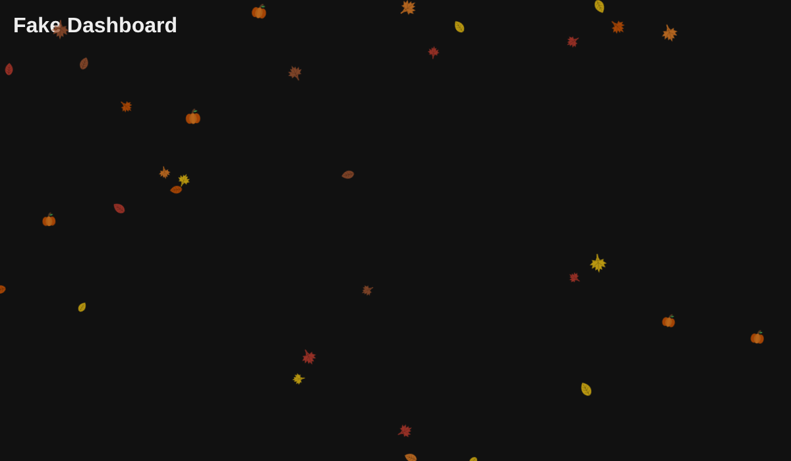
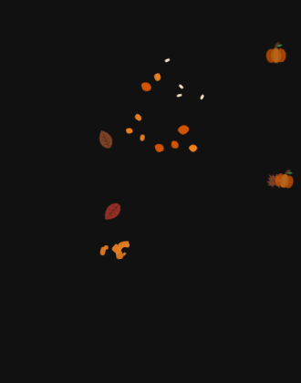

# Autumn mode for Home Assistant 🎃🍂

Falling autumn leaves (maple and regular leaves) and pumpkins across the entire Home Assistant frontend.
Modeled after the official Labs winter mode (`ha-snowflakes.ts`).



## Installation

1. Copy `ha-autumn-mode.js` to `/config/www/ha-autumn-mode.js` (e.g. via the File Editor or Samba add-on).
2. Create a helper: **Settings → Devices & services → Helpers → Create helper → Toggle**,
   named **Autumn Mode** (the entity ID must be `input_boolean.autumn_mode`).
3. Load the file, pick one of the two options:
   - **Everywhere (recommended):** add to `configuration.yaml`
     ```yaml
     frontend:
       extra_module_url:
         - /local/ha-autumn-mode.js
     ```
     then restart Home Assistant.
   - **Without a restart:** Settings → Dashboards → ⋮ → Resources → Add resource,
     URL `/local/ha-autumn-mode.js`, type **JavaScript module**. It starts as soon as a dashboard has been loaded.
4. Hard-reload the browser (Ctrl+F5), or clear the frontend cache in the Companion app.

## Usage

- Toggle `input_boolean.autumn_mode` on = leaves falling, off = gone (reacts within about a second).
- If the helper does not exist, autumn mode is always on.
- Works great with automations, e.g. turn it on on September 1st and off on November 30th.
- Just like winter mode: if "reduce motion" is enabled in the device's accessibility settings, nothing is shown.

## Click fun 💥



Click or tap a leaf and it crumbles. Click a pumpkin and it bursts into chunks and seeds.
The item then comes back in from the top. Clicks still pass through to the dashboard,
so if a leaf is on top of a button, the button gets pressed too.
On phones there are 14px of extra hit area (`TOUCH_SLOP`).

## Customization (top of the JS file)

| Constant | Default | Meaning |
| --- | --- | --- |
| `AUTUMN_ENTITY` | `input_boolean.autumn_mode` | Toggle entity |
| `MAX_ITEMS` | 40 | Number of items on large screens |
| `MAX_ITEMS_NARROW` | 24 | Number of items on phones |
| `PUMPKIN_SHARE` | 0.2 | Share of pumpkins (0.2 = 20%) |
| `TOUCH_SLOP` | 14 | Extra hit area in px |
| `LEAF_COLORS` | orange, red, yellow, brown | Leaf colors |

Clear the browser cache after changing the file.

## License

GPL-3.0, see [LICENSE](LICENSE).
